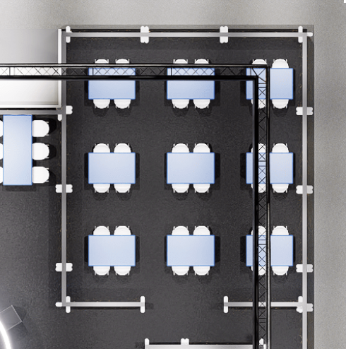
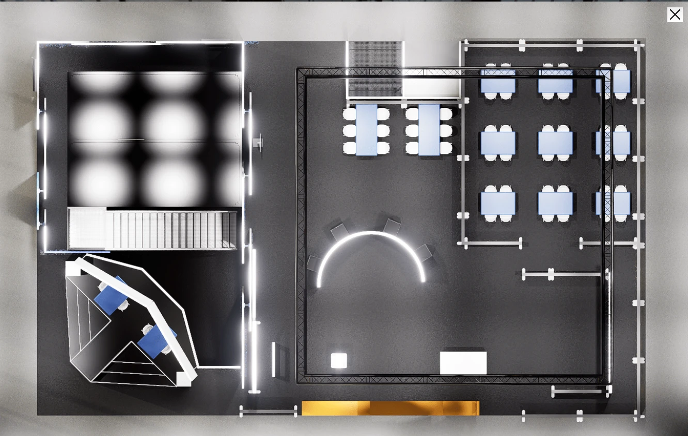
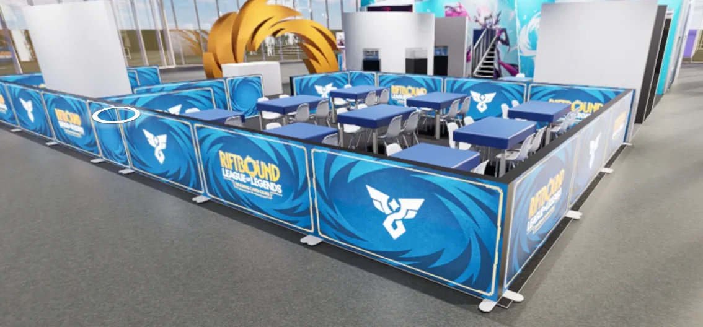

# Lobby Riftbound – Paris Games Week

Application de **file d'attente et de placement aux tables** pour le stand
**Riftbound** (set **Radiance**) de la Paris Games Week.

Les visiteurs s'inscrivent à l'accueil ; l'application les place
automatiquement à une table dès qu'un emplacement se libère, lance un compte à
rebours d'**1 heure** par partie et affiche le tout en temps réel sur une TV.
Rester jusqu'au bout donne droit aux **goodies**.

## Fonctionnalités

**Accueil (`/accueil`, protégé par mot de passe)**

- Inscription de **1 joueur** ou de **2 joueurs ensemble** (prénom, nom, email,
  numéro de billet), avec vérification immédiate des doublons : un email ou un
  billet ne sert qu'**une fois sur tout le salon**.
- Placement **automatique** : tables entièrement libres d'abord, puis
  demi-tables ; deux joueurs seuls sont associés automatiquement ; un joueur
  seul peut être **« placé quand même »** contre un animateur.
- Panneau **« À appeler »** : les joueurs placés automatiquement (ou associés à
  un joueur seul, ou « placés quand même ») restent listés avec leur table
  jusqu'à « Installés » ; liste mémorisée sur le poste.
- Plan des 9 tables avec les comptes à rebours ; un clic sur un emplacement
  ouvre son panneau d'actions : **+5 / −5 min**, **« Absent »**,
  **« Libérer »** (départ anticipé, sans goodies), table hors service.
- **« Absent »** sur chaque joueur placé, pendant les **15 premières minutes** de
  la partie : il est retiré sans goodies et pourra se réinscrire ; son
  partenaire continue contre un animateur (ou, s'il ne reste personne, la
  partie est annulée et l'emplacement réattribué). Au-delà : « Libérer » (qui
  sort les deux joueurs) s'il n'y a plus personne, sinon la partie continue.
- File d'attente : **« Retirer »** un joueur absent (il pourra se réinscrire).
- Liste **« Goodies à remettre »** avec bouton « Remis ».
- Recherche et correction d'un participant.
- Réglages : durée des parties (1 h par défaut), tables hors service.
- **« Fermer le stand »** le soir : plus aucun placement automatique (les
  parties en cours vont jusqu'au bout, goodies compris ; la file reste affichée
  à l'accueil mais personne n'est placé). **« Rouvrir le stand »** pour
  reprendre. Ce n'est pas une pause en journée : l'écran TV annonce alors la
  fin de la journée (pour une pause, mettre les tables hors service).
- **« Nouvelle journée »** chaque matin (vide la file, rouvre le stand, garde
  tout l'historique).
- **Export CSV** de tous les participants (compatible Excel).

**Écran TV (`/ecran`, public)**

- Plan du stand (9 tables × 2 matchs), noms des joueurs, temps restant, file
  d'attente avec l'heure de passage estimée, en temps réel.
- **Attente estimée pour une nouvelle inscription** (« ~20 min », ou « places
  libres maintenant ») et liste **« À vos tables ! »** des joueurs placés depuis
  moins de 3 minutes (étiquette « Nouveau » sur leur emplacement).
- N'affiche que **« Prénom N. »** : jamais d'email ni de numéro de billet.
- Stand fermé (le soir) : l'écran l'annonce à la place de la file d'attente.
- Mise en page paysage ou portrait (Full HD), rotation possible
  (`/ecran?rotation=90`, `/ecran?orientation=portrait`).

**Fiabilité**

- Les timers sont calculés **côté serveur** à partir de l'heure de fin
  enregistrée : ils résistent aux rafraîchissements, aux coupures réseau du
  stand et aux redémarrages du serveur.
- Temps réel par Socket.IO : si le Wi-Fi du salon ou un proxy bloque les
  WebSockets, les pages se replient sur du **long-polling** HTTP et restent à
  jour.
- Toutes les données sont dans une petite base **SQLite** (`lobby.db`).

Les règles métier détaillées, validées avec le client, sont dans
[PLAN.md](PLAN.md).

## Interface

Direction artistique **« Aurore holographique »** (set Radiance), sur
l'ergonomie de la version éditoriale retenue : fond nacré perle, halos irisés
cyan → lavande → rose et cercles concentriques du key art, cartes en verre
clair aux ombres douces, mot **RADIANCE** en chrome bleu-argent, médaillons de
table et anneaux de progression irisés, polices **Outfit** (titres, noms,
chiffres) et **Inter** (texte courant) auto-hébergées, **logo officiel**
Riftbound posé sur une carte nacrée (jamais à nu sur le halo). Le fond est
pré-calculé en dégradés **statiques** (aucun `filter: blur`, aucun halo animé,
pas de `backdrop-filter`) pour rester fluide sur le mini-PC du stand.

Couleurs, avec le même sens sur la TV et à l'accueil : **orange Riftbound =
action / à faire** (bouton principal, places libres, « À suivre »,
« À appeler » ; toujours du texte encre sur l'orange, orange foncé `#A84300`
pour du texte orange), **rose = 5 dernières minutes**, **mauve = stand fermé**
(« crépuscule ») ou animateur, vert = terminé / remis, hachures grises = hors
service, rouge = irréversible ou panne ; sur la TV, un cadre **cyan** et
l'étiquette « Nouveau » désignent les joueurs qui viennent d'être placés.
Contrastes WCAG 2.1 AA vérifiés, fond irisé compris. Le focus clavier est un
contour plein cyan foncé (`#1D6F8A`, 5,7:1 sur blanc), remplacé par un contour
couleur système en mode contraste élevé de Windows. Les couleurs, le fond et
les composants communs sont dans `public/shared/theme.css`.

**Accueil (`/accueil`)**, organisé autour de la boucle de travail de
l'hôtesse :

- **Barre du haut** : jour du salon, compteurs cliquables (En attente, En jeu,
  Terminés, Goodies, Total), **Rechercher** (Alt + R), état de la connexion,
  **Réglages**, **Fermer le stand**, **Nouvelle journée**, menu **« ⋯ »**
  (Exporter CSV, Déconnexion). Les notifications s'affichent quelques secondes
  sur cette barre, sans couvrir les panneaux.
- **01 Inscrire** (colonne de gauche) : formulaire 1 ou 2 joueurs (joueur 1 =
  chaise du haut, joueur 2 = chaise du bas), vérification des doublons en
  direct, attente estimée (même calcul que la TV), **cadre de résultat** à
  annoncer (« → Table 4 · B », rang dans la file, joueur seul…), qui suit la
  situation du joueur.
- **02 À appeler** (en haut au centre) : une carte par placement automatique
  (plaque table + A/B, noms complets, « prévenir un animateur » si besoin),
  bouton **« Installés »**, **« Tout marquer installés »**, menu « ⋯ » avec
  **« Absent : nom »** (15 premières minutes) et l'ouverture de l'emplacement.
  Liste mémorisée sur le poste (`localStorage`) ; sur un nouvel appareil, les
  placements des 3 dernières minutes sont repris.
- **Plan des tables** (au centre) : chaque emplacement montre l'essentiel
  (lettre dans un anneau de temps irisé, compte à rebours, noms, « Nouveau » /
  « À appeler ») ; un
  clic ouvre le **panneau d'actions de l'emplacement** : compte à rebours,
  joueurs avec email et billet, **« Absent »** (avec le délai restant),
  **−5 / +5 min**, **« Libérer l'emplacement… »** isolé en bas (confirmation
  avec « Annuler » par défaut) ; pour un emplacement libre, mise hors service
  de la table.
- **03 Goodies à remettre** et **File d'attente** (colonne de droite) : bouton
  « Remis » / « Annuler » ; file avec rang, heure de passage estimée,
  « Placer quand même (vs animateur) » visible pour un joueur seul, et
  « Modifier » / « Retirer » dans le menu « ⋯ » de chaque ligne.
- **Bandeaux** pleine largeur : « Stand fermé » (mauve, avec « Rouvrir le
  stand » ; orange foncé le matin, avec « Nouvelle journée »), « Connexion au
  serveur perdue » (rouge).
- De 1280 à 1920 px de large : trois colonnes. En dessous (tablette 1024 × 768),
  deux colonnes, avec des onglets Plan / File / Goodies. Cibles tactiles d'au
  moins 44 px.

**Écran TV (`/ecran`)** : en-tête (logo officiel dans une carte nacrée, mot
« Radiance » en chrome bleu-argent, horloge, « En direct » / « Reconnexion… »),
plan fidèle au stand
(enceinte, entrée en bas, plaques de table numérotées, A à gauche / B à droite,
joueur 1 en haut / joueur 2 en bas), carte **attente estimée**, liste
**« À vos tables ! »**, file d'attente (deux colonnes lues ligne par ligne en
portrait), bandeau d'appel en bas. Les noms longs sont réduits ou passent sur
deux lignes plutôt que d'être coupés. Animations limitées à `transform` et
`opacity` (coupées si `prefers-reduced-motion`).

## Captures d'écran

Les captures de l'écran TV et de l'accueil ne sont pas encore dans le dépôt.
Pour en produire : lancez l'application avec les données de démonstration (voir
plus bas), ouvrez `/ecran` en 1920 × 1080 (F11) et `/accueil`, puis faites des
captures. Emplacement conseillé : `docs/captures/` (par ex.
`docs/captures/ecran.png`, `docs/captures/accueil.png`).

Plans du stand ayant servi de référence :

| Zone des 9 tables | Stand complet | Rendu 3D |
|---|---|---|
|  |  |  |

## Démarrer sur un ordinateur

Prérequis : **Node.js 22** ou plus récent (`node -v` pour vérifier).

```sh
npm install
npm start
```

Puis ouvrez :

- écran TV : <http://localhost:3000/ecran>
- accueil : <http://localhost:3000/accueil> — mot de passe de développement :
  **`riftbound`** (utilisé seulement si `ACCUEIL_PASSWORD` n'est pas défini et
  hors production ; un avertissement s'affiche alors dans le terminal).

Les données sont enregistrées dans `data/lobby.db` (dossier ignoré par Git).
Pour repartir de zéro, arrêtez l'application et supprimez le dossier `data/`.

`npm run dev` relance automatiquement le serveur à chaque modification du code.

### Données de démonstration

Pour voir l'écran rempli (tables occupées avec des comptes à rebours variés,
un joueur seul, une file d'attente), utilisez une base séparée :

```sh
DATA_DIR=./data-demo node scripts/demo-seed.js
DATA_DIR=./data-demo npm start
```

Sous Windows (PowerShell) :

```powershell
$env:DATA_DIR = "./data-demo"; node scripts/demo-seed.js; npm start
```

Variables facultatives du script : `SEED_PAIRS` (paires déjà en jeu, 17 par
défaut) et `SEED_QUEUE` (paires en file, 6 par défaut). **Ne lancez jamais ce
script sur la base de production** : il y ajouterait de faux participants.

### Tests

```sh
npm test
```

Tests automatisés (`node:test`, avec une horloge simulée pour les timers),
dans le dossier `test/`.

### Avec Docker (facultatif)

```sh
ACCUEIL_PASSWORD='un-mot-de-passe' docker compose up -d --build
```

L'application est alors sur <http://localhost:3000>, avec ses données dans le
volume Docker `lobby-data`. Voir [docker-compose.yml](docker-compose.yml) et le
[Dockerfile](Dockerfile). Ce fichier règle `TRUST_PROXY=false` (port 3000 joint
directement) : si vous placez un proxy HTTPS devant, changez-la (voir
[Variables d'environnement](#variables-denvironnement)).

## Variables d'environnement

| Variable | Rôle | Par défaut |
|---|---|---|
| `ACCUEIL_PASSWORD` | Mot de passe de l'accueil. **Obligatoire en production** : sans elle, l'application refuse de démarrer quand `NODE_ENV=production`. | `riftbound` en développement uniquement |
| `SESSION_SECRET` | Clé de signature des sessions de l'accueil. Facultative. | générée au premier démarrage et conservée dans la base |
| `DATA_DIR` | Dossier de la base `lobby.db`. | `./data` (local) · `/data` (image Docker) |
| `PORT` | Port HTTP. | `3000` |
| `NODE_ENV` | `production` active les contrôles de production. | non défini (local) · `production` (image Docker) |
| `TZ` | Fuseau horaire du serveur (les heures affichées et exportées sont de toute façon à l'heure de Paris). | `Europe/Paris` dans l'image Docker |
| `TRUST_PROXY` | Proxys dont l'application croit les en-têtes `X-Forwarded-For` / `X-Forwarded-Proto` (adresse IP du visiteur, HTTPS). Voir ci-dessous. | `loopback, linklocal, uniquelocal` · `false` dans `docker-compose.yml` |

Changer `ACCUEIL_PASSWORD` ou `SESSION_SECRET` déconnecte toutes les sessions
de l'accueil. Une session dure 7 jours. Après 10 mauvais mots de passe en
5 minutes depuis une même adresse IP, la connexion est bloquée 5 minutes.

**`TRUST_PROXY`.** Par défaut, l'application ne croit les en-têtes
`X-Forwarded-*` que s'ils viennent d'une adresse locale ou privée (loopback,
lien local, réseaux privés `10.x`, `172.16–31.x`, `192.168.x`, `fc00::/7`) :
c'est le cas du proxy de Coolify (Traefik), donc **rien à régler sur
Coolify**. Changez-la :

- **`false`** si le port de l'application est joint **directement, sans proxy**
  devant (`docker run -p 3000:3000`, `docker compose`) : personne ne doit alors
  être cru, sinon un appareil du réseau local (adresse privée) pourrait fausser
  son adresse IP ou se faire passer pour une connexion HTTPS ;
- l'**adresse ou le sous-réseau du proxy** si votre proxy n'a pas une adresse
  locale ou privée (sinon, derrière lui, la connexion HTTPS n'est pas reconnue
  et tous les visiteurs partagent l'adresse du proxy).

Valeurs acceptées : `true` ou `false` (majuscules indifférentes), un **nombre**
de proxys successifs devant l'application, ou une **liste** d'adresses, de
sous-réseaux ou de mots-clés (`loopback`, `linklocal`, `uniquelocal`) séparés
par des virgules, par exemple `10.0.0.0/8, 127.0.0.1`. Vide ou absente : valeur
par défaut. `true` (tout croire) est déconseillé. Une valeur invalide empêche
le démarrage (`TRUST_PROXY invalide (…)` dans les journaux).

**HTTPS.** Quand la page est servie en HTTPS (d'après le proxy de confiance), le
cookie de session est marqué `Secure` et l'application envoie l'en-tête HSTS
(`Strict-Transport-Security: max-age=31536000`) : pendant **un an**, les
navigateurs qui ont visité le domaine refusent d'y revenir en HTTP simple.
Gardez donc ce domaine en HTTPS. En HTTP (essais, adresse `sslip.io`), ni
`Secure` ni HSTS.

## Adresses

| Adresse | Rôle |
|---|---|
| `/` | redirige vers `/ecran` |
| `/ecran` | écran TV public (options `?orientation=portrait`, `?rotation=90`) |
| `/accueil` | interface de l'hôtesse (renvoie vers `/login` si non connecté) |
| `/login` | connexion (mot de passe unique) |
| `/api/export.csv` | export CSV de tous les participants (connecté) |
| `/healthz` | sonde de santé : `{"ok":true}` |

## Structure du projet

```
├── server/
│   ├── index.js        serveur Express + Socket.IO, routes, actions de l'accueil
│   ├── lobby.js        moteur métier : inscriptions, file, placement, timers
│   ├── db.js           base SQLite (schéma)
│   ├── auth.js         mot de passe de l'accueil, cookie de session signé
│   └── csv.js          export CSV (Excel, heure de Paris)
├── public/
│   ├── ecran/          écran TV
│   ├── accueil/        interface de l'hôtesse
│   ├── login.html      page de connexion
│   ├── shared/         client temps réel commun (client.js) et thème (theme.css)
│   └── assets/         logo officiel et visuels (voir public/assets/README.md)
├── scripts/
│   └── demo-seed.js    données de démonstration
├── test/               tests automatisés (npm test)
├── docs/               guides et plans du stand
├── Dockerfile          image de production (utilisée par Coolify)
├── docker-compose.yml  lancement avec Docker hors Coolify
└── PLAN.md             règles métier et choix techniques
```

Aucune étape de construction côté navigateur : HTML, CSS et JavaScript sont
servis tels quels. La police (Inter) est auto-hébergée : l'écran fonctionne sans
dépendre de Google Fonts ni d'un CDN.

## Documentation

- [Déploiement sur Coolify (VPS Hostinger)](docs/DEPLOIEMENT-COOLIFY.md) :
  mise en ligne, nom de domaine et HTTPS, sauvegardes, mises à jour, dépannage.
- [Guide de l'accueil](docs/GUIDE-ACCUEIL.md) : pour les hôtesses et
  animateurs du stand.
- [Plan et règles métier](PLAN.md).
- [Logos et visuels (en place, attendus)](public/assets/README.md).

## Mentions

Riftbound, Radiance et les visuels associés sont la propriété de Riot Games et
UVS Games. Le logo Riftbound de `public/assets/` est le fichier officiel fourni
pour l'événement ; le logotype Radiance et un visuel HD sont encore attendus
(voir `public/assets/README.md`).
